


 

  

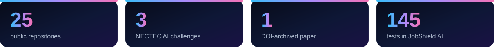

 

First-year student at **Burapha University**. I build data-heavy software and reproducible research: multi-agent systems, compliance-aware web apps, and pre-registered quantitative studies. I write down what a project does *not* show, and I link evidence for every claim on this page.

 

<a href="https://github.com/bravforcode/Quant-paper"></a>
<a href="https://github.com/bravforcode/gmx-g5-prospective-2026"></a>
<a href="https://github.com/bravforcode/graxia-os"></a>
<a href="https://github.com/bravforcode/adminmate-ai"></a>
<a href="https://github.com/bravforcode/enterprise-agent-os"></a>
<a href="https://jobsume.vercel.app"></a>

 

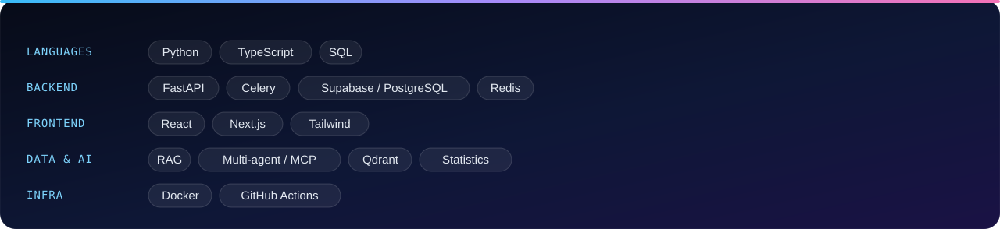

 

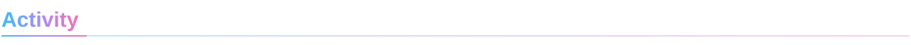

<picture>
  <source media="(prefers-color-scheme: dark)" srcset="profile-3d-contrib/profile-night-rainbow.svg">
  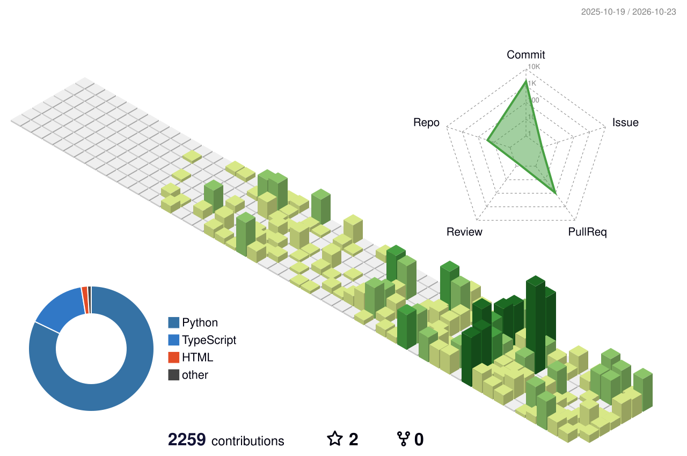
</picture>

<picture>
  <source media="(prefers-color-scheme: dark)" srcset="https://raw.githubusercontent.com/bravforcode/bravforcode/output/github-contribution-grid-snake-dark.svg">
  
</picture>

 

| Year | Item | Result | Proof |
|---|---|---|---|
| 2026 | AI Thailand Benchmark (NECTEC): LOTUSDIS, Meeting Minutes, LLM Trustworthiness | Qualified for 3 challenges | [LOTUSDIS](certificates/ai-thailand-lotusdis-2026-03.pdf) · [Meeting Minutes](certificates/ai-thailand-meeting-minutes-2026-05.pdf) · [LLM Trustworthiness](certificates/ai-thailand-llm-trustworthiness-2026-07.pdf) |
| 2026 | EEC-SDG Hackathon, Burapha University | Shortlisted for final pitching | [Shortlist](certificates/eec-sdg-shortlisted-2026-08.pdf) |
| 2026 | Mahidol × Harvard Health Systems Hackathon | Selected participant | [Schedule](certificates/onsite-schedule-2026-03-17.pdf) |
| 2025 | Thailand Cyber Top Talent (NCSA) | Certificate of appreciation | [Certificate](certificates/thailand-cyber-talent-2025.jpg) |
| 2025 | THNIC Academy: Introduction to Programming | Completed | [Certificate](certificates/thnic-intro-programming-2025.jpg) |

<b>Certificate gallery</b>

 

| | | |
|---|---|---|
| [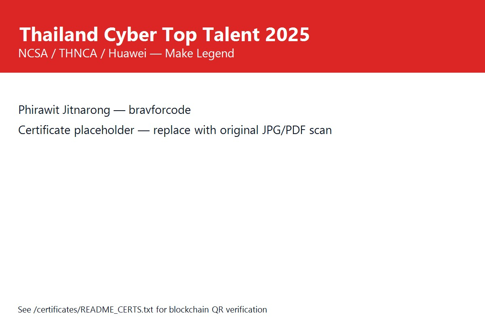](certificates/thailand-cyber-talent-2025.jpg) | [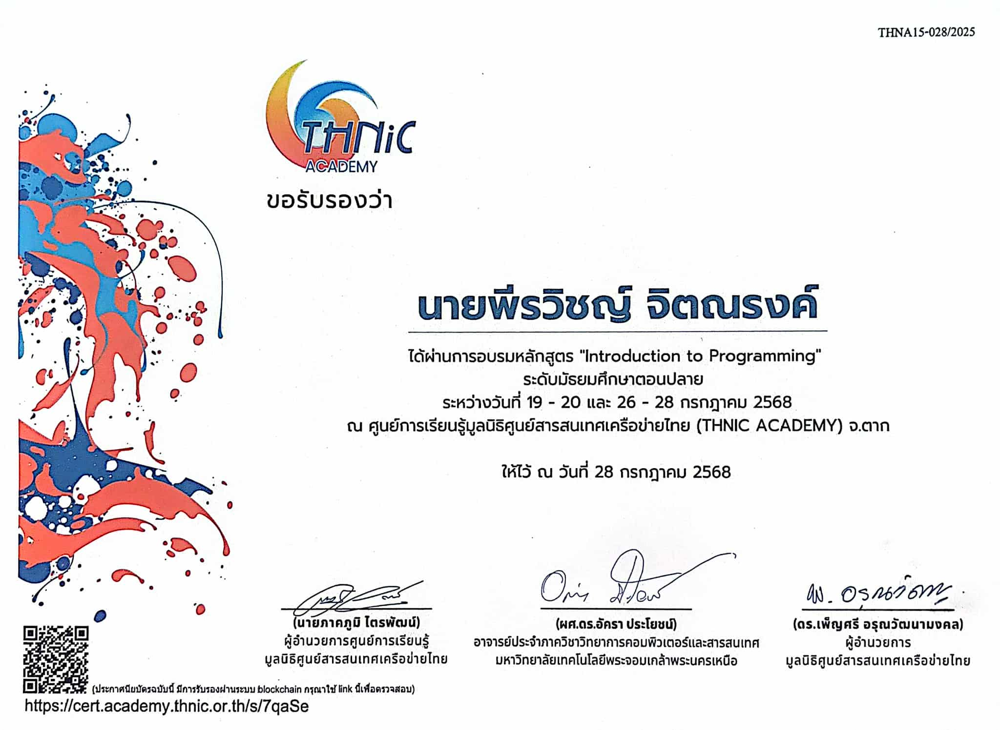](certificates/thnic-intro-programming-2025.jpg) | [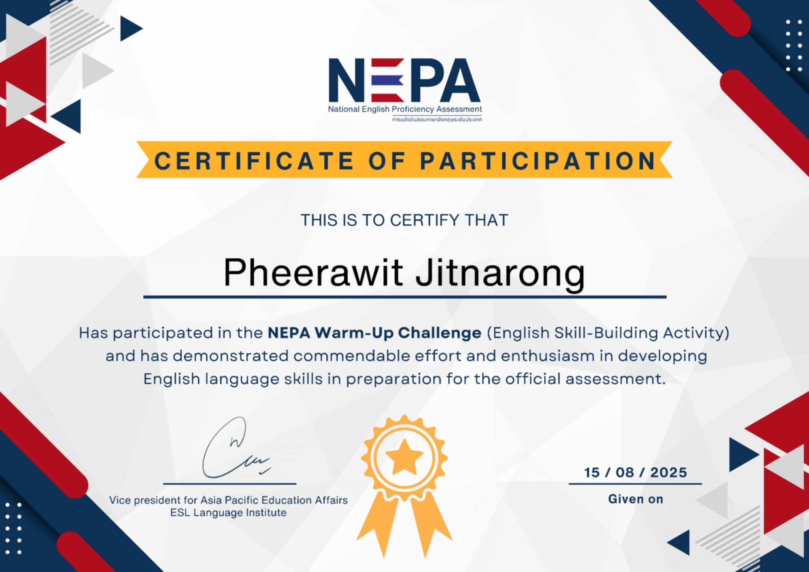](certificates/nepa-warmup-2025.jpg) |
| [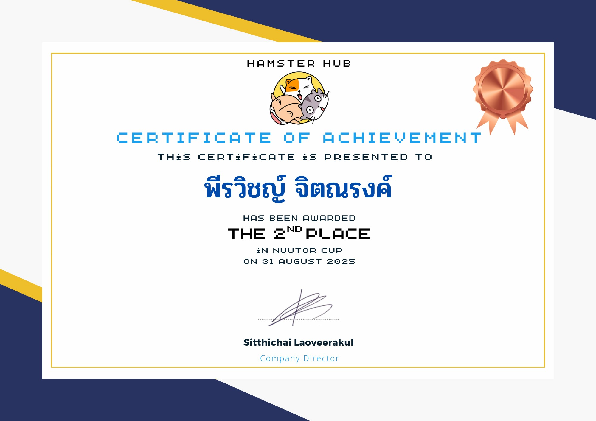](certificates/nuutor-cup-hamster-hub-2nd-2025.jpg) | [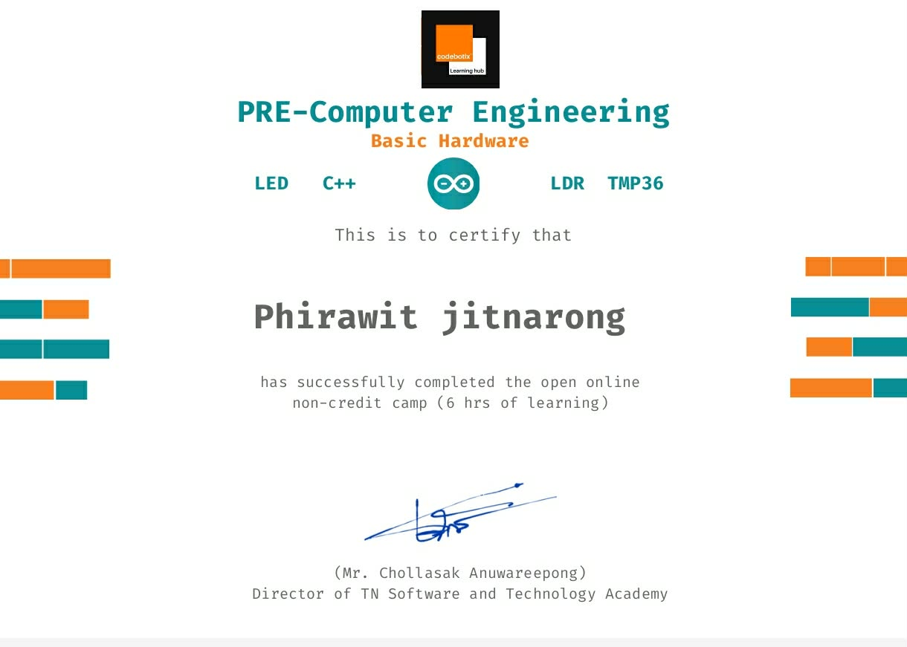](certificates/pre-computer-engineering-basic-hardware.jpg) | |

 

- Running the **GMX G5 prospective collection** (closes 11 Oct 2026).
- Revising the **CPIV methods note** (latest archived release: v28).
- Looking for an **internship** where I can work on data systems, ML or quantitative research.

 

AI-assisted workflow: I use Claude Code for drafting and tests. Design decisions and verification are mine; see the commit trailers. Assets on this page are generated by <a href="scripts/build_assets.py"><code>scripts/build_assets.py</code></a>.
