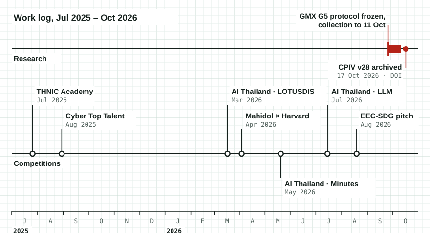

# Phirawit Jitnarong

**Full-Stack & AI engineer · Data / Quant research** · พีรวิชญ์ จิตณรงค์

First-year student, Burapha University, Thailand. Looking for an internship in 2027.

[LinkedIn](https://www.linkedin.com/in/phirawit-jitnarong/) · [nxme176@gmail.com](mailto:nxme176@gmail.com) · [Research on Zenodo](https://doi.org/10.5281/zenodo.23442600) · [ภาษาไทย](README.th.md)

I build data-heavy software and reproducible research. Every row below links to its evidence, and where something is a prototype or runs on mock data, it says so.

<picture>
  <source media="(prefers-color-scheme: dark)" srcset="assets/log-dark.svg">
  
</picture>

## Research

| Date | Entry | Evidence |
|---|---|---|
| 2026‑10‑17 | **CPIV methods note.** Call–put implied-volatility spreads: exact Black–Scholes–Merton inversion, and how reliable the spread is under synthetic quote noise. Synthetic data only; no alpha claim; no independent replication yet. | [DOI 10.5281/zenodo.23442601](https://doi.org/10.5281/zenodo.23442601) · [code and tests](https://github.com/bravforcode/Quant-paper) |
| 2026‑09‑26 | **GMX G5 prospective record.** Protocol frozen before the baseline (SHA-256 `efa241ab…`), then four fixed-time snapshots a day, saved as aggregate receipts. Collection ends 11 Oct 2026. | [repository](https://github.com/bravforcode/gmx-g5-prospective-2026) · [frozen protocol](https://gist.github.com/bravforcode/d139701fb92b4dad22e89756e9e14fa8) |

## Software

| Project | What it does | Built with | Evidence |
|---|---|---|---|
| **Graxia OS** | Personal AI chief of staff. Finds leads, scores fit and risk, drafts outreach, and waits for human approval before anything is sent. | FastAPI, Celery, Redis, PostgreSQL, React | [code](https://github.com/bravforcode/graxia-os) · Docker Compose quickstart · backend tests and Playwright e2e |
| **AdminMate AI** | HR platform for SMEs, from recruitment to payroll with Thai tax rules, with row-level security in the database. | React 19, Supabase, Gemini | [code](https://github.com/bravforcode/adminmate-ai) · pgTAP suite in `supabase/` |
| **JobShield AI** | Career-path recommender on a skill graph, with a wage-gap radar. Runs on 153 hand-written job postings, not real labour-market data. | Next.js, Python | [live demo](https://jobsume.vercel.app) · [code](https://github.com/bravforcode/jobshield-ai) · 145 tests |
| **Enterprise Agent OS** | MCP server with 15 sub-agents and seven orchestration patterns. Reference implementation; archived. | Python, FastAPI, Qdrant, PostgreSQL | [code](https://github.com/bravforcode/enterprise-agent-os) |

## Competitions and courses

| Date | Event | Result | Proof |
|---|---|---|---|
| 2026‑08 | EEC-SDG Hackathon, Burapha University | Shortlisted for final pitching | [shortlist](certificates/eec-sdg-shortlisted-2026-08.pdf) |
| 2026‑07 | AI Thailand Benchmark (NECTEC): LLM Trustworthiness | Qualified | [confirmation](certificates/ai-thailand-llm-trustworthiness-2026-07.pdf) |
| 2026‑05 | AI Thailand Benchmark: Meeting Minutes Summarization | Qualified | [confirmation](certificates/ai-thailand-meeting-minutes-2026-05.pdf) |
| 2026‑04 | Mahidol × Harvard Health Systems Hackathon | Selected participant | [schedule](certificates/onsite-schedule-2026-03-17.pdf) |
| 2026‑03 | AI Thailand Benchmark: LOTUSDIS distant-meeting transcription | Qualified | [confirmation](certificates/ai-thailand-lotusdis-2026-03.pdf) |
| 2025‑08 | Thailand Cyber Top Talent (NCSA) | Certificate of appreciation | [certificate](certificates/thailand-cyber-talent-2025.jpg) |
| 2025‑07 | THNIC Academy: Introduction to Programming | Completed | [certificate](certificates/thnic-intro-programming-2025.jpg) |

## Tools

- **Languages:** Python, TypeScript, SQL
- **Backend:** FastAPI, Celery, Redis, PostgreSQL, Supabase
- **Frontend:** React, Next.js, Tailwind CSS
- **Data and AI:** retrieval-augmented generation, multi-agent systems and MCP, Qdrant, statistics
- **Infrastructure:** Docker, GitHub Actions

## Contribution record

<picture>
  <source media="(prefers-color-scheme: dark)" srcset="profile-3d-contrib/profile-night-green.svg">
  
</picture>

<picture>
  <source media="(prefers-color-scheme: dark)" srcset="https://raw.githubusercontent.com/bravforcode/bravforcode/output/github-contribution-grid-snake-dark.svg">
  
</picture>

Certificate images

 

| | | |
|---|---|---|
|  |  |  |
|  |  | |

I use Claude Code for drafting and tests; design decisions and verification are mine, and the commit trailers show where it was used. Fig. 1 is generated by <a href="scripts/build_figure.py"><code>scripts/build_figure.py</code></a>.
